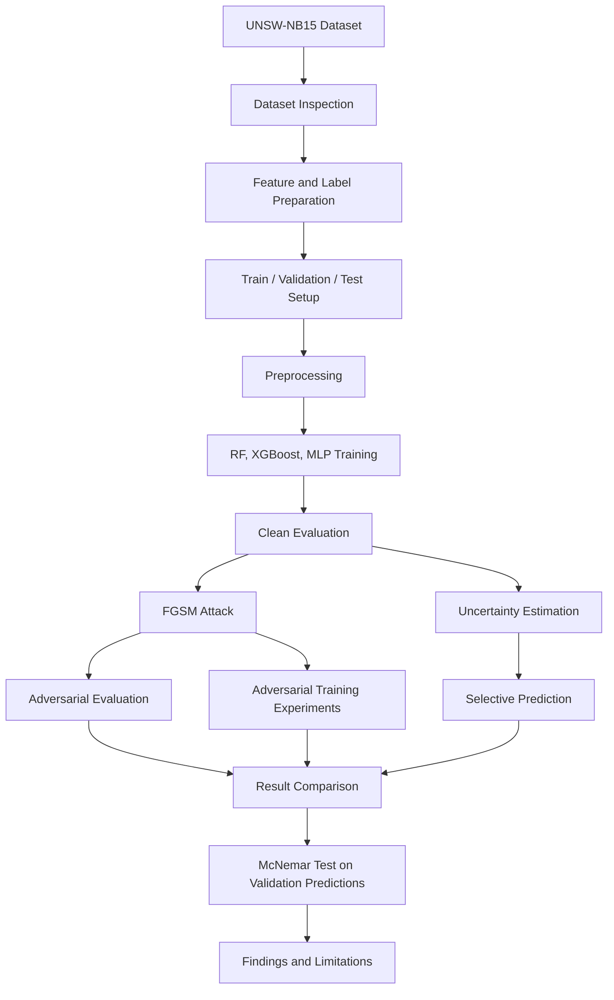
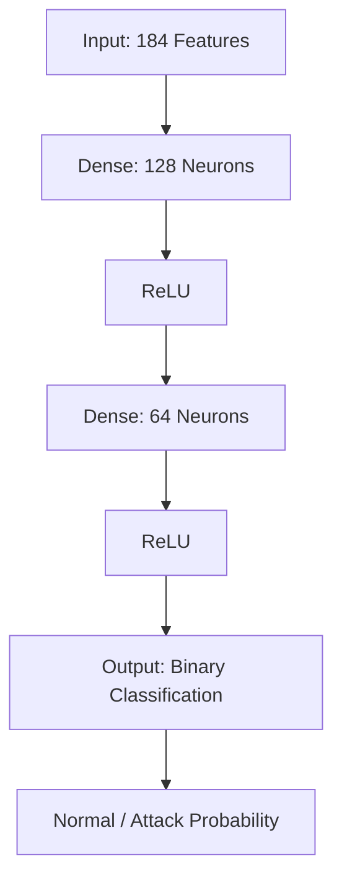
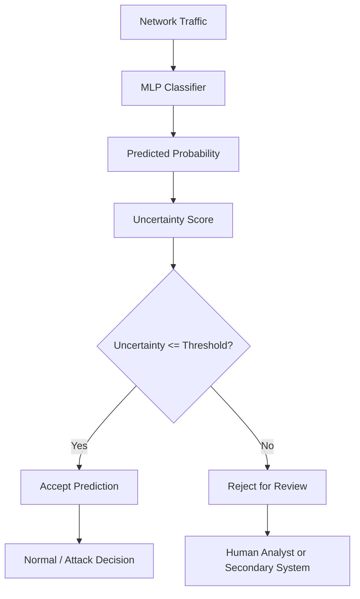
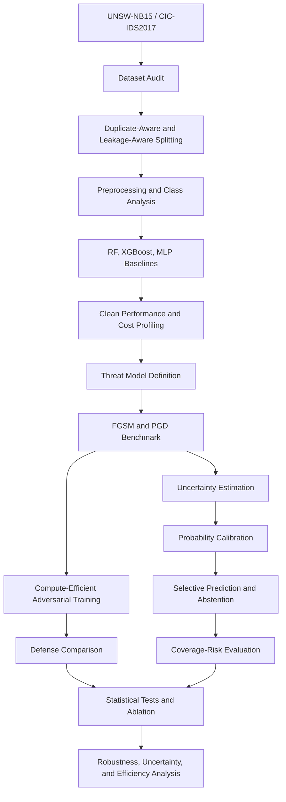

# Uncertainty-Aware Adversarial Defense for Security-Critical Intrusion Detection

[]()
[]()
[]()

An academic machine-learning project investigating adversarial
vulnerabilities in network intrusion detection, confidence-based
uncertainty estimation, selective prediction, and adversarial training
using the **UNSW-NB15** dataset.

> **Reproducibility and honesty note:** This README distinguishes
> completed experiments from proposed future work. FGSM,
> confidence-based uncertainty, selective prediction, two exploratory
> adversarial-training experiments, and validation-set McNemar testing
> were completed. PGD, Temperature Scaling, ECE/Brier calibration
> evaluation, and duplicate-aware re-evaluation were not completed.

## Table of Contents

1.  [Overview](#1-project-overview)
2.  [Problem and Motivation](#2-problem-and-motivation)
3.  [Objectives and Research
    Questions](#3-objectives-and-research-questions)
4.  [Workflow](#4-system-workflow)
5.  [Dataset](#5-dataset-description)
6.  [Preprocessing](#6-data-preparation-and-preprocessing)
7.  [Baseline Models](#7-baseline-models)
8.  [Evaluation Metrics](#8-evaluation-metrics)
9.  [FGSM Adversarial Evaluation](#9-fgsm-adversarial-evaluation)
10. [Uncertainty Estimation](#10-uncertainty-estimation)
11. [Selective Prediction](#11-selective-prediction)
12. [Adversarial Training](#12-adversarial-training)
13. [Statistical Validation](#13-statistical-validation)
14. [Results and Findings](#14-results-and-findings)
15. [Limitations](#15-limitations)
16. [Proposed Improved Pipeline](#16-proposed-improved-pipeline)
17. [Future Work](#17-future-work)
18. [Reproduction](#18-reproduction)
19. [Suggested Repository Structure](#19-suggested-repository-structure)
20. [References](#20-references)

------------------------------------------------------------------------

## 1. Project Overview

Machine-learning-based Intrusion Detection Systems (IDS) classify
network traffic as normal or malicious. Although a model may perform
well on clean test data, deliberately perturbed inputs can cause
incorrect predictions.

This project investigates:

-   Baseline intrusion detection performance using Random Forest,
    XGBoost, and Multi-Layer Perceptron (MLP).
-   MLP vulnerability under gradient-based FGSM adversarial
    perturbations.
-   Confidence-based uncertainty estimation.
-   Selective prediction, where high-uncertainty predictions are
    rejected for secondary inspection.
-   Single-epsilon and multi-epsilon adversarial training.

The broader research direction is to study the trade-off among detection
performance, adversarial robustness, uncertainty, selective risk, and
computational cost.

## 2. Problem and Motivation

A false negative may allow malicious traffic to pass undetected, while a
false positive may create unnecessary security alerts. Adversarial
machine learning introduces a further risk: an attacker may modify input
features to influence a trained model's prediction.

Therefore, IDS evaluation should consider more than clean-data accuracy.
It should also investigate robustness to perturbations, prediction
reliability, rejection of uncertain predictions, and the computational
cost of defensive methods.

## 3. Objectives and Research Questions

### Objectives

-   Prepare UNSW-NB15 for binary intrusion detection.
-   Train and compare Random Forest, XGBoost, and MLP.
-   Evaluate clean-data and adversarial performance.
-   Generate FGSM examples at different perturbation strengths.
-   Estimate uncertainty from predicted probabilities.
-   Evaluate threshold-based selective prediction.
-   Explore adversarial training and compare it with the original MLP.
-   Perform paired statistical validation on validation predictions.
-   Record baseline training time.

### Research questions

**RQ1.** How does adversarial perturbation affect machine-learning-based
intrusion detection?

**RQ2.** Can confidence-based uncertainty identify predictions that
should be rejected for secondary inspection?

**RQ3.** Do the explored adversarial-training strategies improve
robustness under the tested FGSM settings?

**RQ4.** What trade-offs exist among clean performance, adversarial
performance, selective prediction, and computational cost?

## 4. System Workflow



## 5. Dataset Description

### UNSW-NB15

The project uses the UNSW-NB15 network intrusion detection dataset.

  Partition                     Records
  --------------------------- ---------
  Original training dataset     175,341
  Original testing dataset       82,332

The binary target is `label`:

-   `0`: Normal traffic
-   `1`: Attack traffic

The `attack_cat` column was excluded from input features because the
experiment performs binary classification using `label`.

There are 34 input features:

-   31 numerical features.
-   3 categorical features: `proto`, `service`, and `state`.

### Class distribution

  Partition             Normal    Attack
  ------------------- -------- ---------
  Original training     56,000   119,341
  Original testing      37,000    45,332

### Dataset quality observations

The inspection identified:

-   78,519 duplicate rows in the original training dataset.
-   32,361 duplicate rows in the original testing dataset.
-   1,487 overlapping unique feature groups between training and
    testing.
-   Conflicting labels among some identical feature groups.

These observations are potential threats to evaluation validity. The
current experiments did not fully eliminate duplicate-group overlap
using group-aware splitting. Results should therefore not be interpreted
as a definitive estimate on fully independent network traffic.

## 6. Data Preparation and Preprocessing

### Feature and target separation

``` python
X = train_df.drop(columns=["label", "attack_cat"])
y = train_df["label"]
```

`X` contains input features and `y` contains the binary target.

### Training-validation split

``` python
X_train, X_val, y_train, y_val = train_test_split(
    X,
    y,
    test_size=0.20,
    random_state=42,
    stratify=y
)
```

  Partition                         Shape
  ------------------------ --------------
  Training features          140,272 × 34
  Validation features         35,069 × 34
  Original test features      82,332 × 34

`stratify=y` preserves class proportions approximately.
`random_state=42` makes the split reproducible. The original test set
was reserved for final evaluation.

**Caveat:** A row-wise stratified split does not guarantee that
duplicate records remain in only one partition.

### Numerical preprocessing

For tree-based models, median imputation was configured:

``` python
numeric_tree_pipeline = Pipeline([
    ("imputer", SimpleImputer(strategy="median"))
])
```

For MLP, median imputation and standardization were configured:

``` python
numeric_mlp_pipeline = Pipeline([
    ("imputer", SimpleImputer(strategy="median")),
    ("scaler", StandardScaler())
])
```

Standardization uses:

\[ z = `\frac{x-\mu}{\sigma}`{=tex} \]

where (x) is the feature value, (`\mu`{=tex}) is the training mean, and
(`\sigma`{=tex}) is the training standard deviation.

### Categorical preprocessing

``` python
categorical_pipeline = Pipeline([
    ("imputer", SimpleImputer(strategy="most_frequent")),
    ("onehot", OneHotEncoder(handle_unknown="ignore"))
])
```

One-hot encoding converts categories into numerical indicator columns.
Unknown categories are ignored rather than causing a transformation
error.

### Combined preprocessing

`ColumnTransformer` applied the numerical and categorical pipelines to
their respective columns. Transformers were fitted on training data and
then applied to validation and test data.

After encoding, the feature matrices contained 184 columns:

  Feature group           Encoded columns
  --------------------- -----------------
  Numerical                            31
  One-hot categorical                 153
  **Total**                       **184**

The encoded matrices were sparse. Dense arrays were created for
PyTorch-based MLP adversarial experiments.

## 7. Baseline Models

Three classifiers were implemented.

### Random Forest

Random Forest combines predictions from multiple decision trees.

``` python
RandomForestClassifier(
    n_estimators=200,
    max_depth=None,
    min_samples_split=2,
    min_samples_leaf=1,
    class_weight="balanced",
    random_state=42,
    n_jobs=-1
)
```

Important parameters:

-   `n_estimators=200`: 200 decision trees.
-   `class_weight="balanced"`: adjusts class weights according to class
    frequencies.
-   `n_jobs=-1`: uses available CPU cores where supported.
-   `random_state=42`: supports reproducibility.

### XGBoost

XGBoost builds trees sequentially, with later trees improving the
ensemble.

``` python
xgb.XGBClassifier(
    n_estimators=200,
    max_depth=6,
    learning_rate=0.1,
    subsample=0.8,
    colsample_bytree=0.8,
    objective="binary:logistic",
    eval_metric="logloss",
    random_state=42,
    n_jobs=-1,
    tree_method="hist"
)
```

### Multi-Layer Perceptron

The MLP is a feed-forward neural network.



``` python
MLPClassifier(
    hidden_layer_sizes=(128, 64),
    activation="relu",
    solver="adam",
    alpha=0.0001,
    batch_size=256,
    learning_rate_init=0.001,
    max_iter=50,
    early_stopping=True,
    validation_fraction=0.1,
    n_iter_no_change=8,
    random_state=42,
    verbose=True
)
```

The MLP stopped at iteration 39 due to early stopping.

## 8. Evaluation Metrics

  -----------------------------------------------------------------------
  Metric                              Meaning
  ----------------------------------- -----------------------------------
  Accuracy                            Fraction of all predictions that
                                      are correct

  Precision                           Fraction of predicted positive
                                      samples that are actually positive

  Recall                              Fraction of actual positive samples
                                      correctly identified

  F1-score                            Harmonic mean of precision and
                                      recall

  ROC-AUC                             Ranking performance across
                                      classification thresholds

  Confusion matrix                    Counts true and false predictions
                                      by class
  -----------------------------------------------------------------------

For intrusion detection, recall is important because false negatives may
represent undetected attacks. Precision is also important because false
positives create unnecessary alerts.

Coverage and selective risk are relevant to selective prediction. ECE
and Brier Score are relevant to calibration, but were not calculated in
the current experiments.

## 9. FGSM Adversarial Evaluation

### Threat model

The implemented attack is a gradient-based, white-box FGSM attack
against the MLP. It:

-   Uses access to input gradients.
-   Perturbs numerical features in standardized feature space.
-   Keeps categorical one-hot features unchanged.
-   Tests multiple perturbation strengths.

This is a constrained feature-space experiment, not a full simulation of
an attacker modifying real network packets. All protocol-level and
physical feature constraints were not enforced.

### FGSM formula

\[ x\_{adv}=x+`\epsilon `{=tex}`\cdot `{=tex}`\operatorname{sign}`{=tex}
`\left`{=tex}(`\nabla`{=tex}\_x L(`\theta`{=tex},x,y)`\right`{=tex}) \]

Where:

-   (x): original input.
-   (x\_{adv}): adversarial input.
-   (`\epsilon`{=tex}): perturbation budget.
-   (L): classification loss.
-   (`\theta`{=tex}): model parameters.
-   (`\nabla`{=tex}\_x L): gradient of loss with respect to input.

Tested epsilon values:

``` python
epsilon_values = [0.01, 0.05, 0.1, 0.2]
```

### Why PyTorch?

The baseline MLP was trained using scikit-learn. Its learned weights and
biases were transferred to an equivalent PyTorch network so gradients
with respect to input features could be calculated.

Conversion check:

  Check                                                       Result
  -------------------------------------- ---------------------------
  scikit-learn MLP validation accuracy                      94.0289%
  PyTorch MLP validation accuracy                           94.0289%
  Maximum probability difference           approximately 5.32 × 10⁻⁷

### FGSM validation results

    Epsilon   Accuracy   Recall   F1-score
  --------- ---------- -------- ----------
       0.00     94.03%   96.76%     95.66%
       0.01     90.37%   93.37%     92.96%
       0.05     76.79%   80.98%     82.61%
       0.10     60.30%   70.32%     70.69%
       0.20     48.40%   58.86%     60.82%

### FGSM final test results

    Epsilon   Accuracy   Precision   Recall   F1-score
  --------- ---------- ----------- -------- ----------
       0.00     85.19%      80.45%   96.58%     87.78%
       0.01     80.15%      75.99%   93.49%     83.84%
       0.05     66.67%      66.22%   80.55%     72.69%
       0.10     44.75%      49.85%   57.79%     53.53%
       0.20     30.66%      38.35%   42.70%     40.41%

**Finding:** MLP performance degraded as epsilon increased under this
FGSM setup.

## 10. Uncertainty Estimation

A confidence-based uncertainty proxy was calculated from the predicted
attack probability (p):

\[ U(x)=1-\|2p-1\| \]

Examples:

    Attack probability   Uncertainty
  -------------------- -------------
                  0.99          0.02
                  0.90          0.20
                  0.50          1.00
                  0.10          0.20
                  0.01          0.02

A probability near 0 or 1 produces low uncertainty under this score; a
probability near 0.5 produces high uncertainty.

Validation uncertainty statistics:

  Statistic                                 Value
  --------------------- -------------------------
  Mean uncertainty                         0.1119
  Median uncertainty      approximately 0.0000107
  Maximum uncertainty        approximately 0.9996

**Limitation:** This is a confidence-based uncertainty proxy. It is not
a formal Bayesian epistemic uncertainty estimate and does not establish
that probabilities are calibrated. Temperature Scaling, ECE, and Brier
Score remain future work.

## 11. Selective Prediction

Selective prediction allows a classifier to abstain when uncertainty is
high.



Thresholds tested on validation data:

``` python
thresholds = [0.2, 0.3, 0.4, 0.5]
```

A prediction was accepted when uncertainty was less than or equal to the
threshold; otherwise, it was rejected.

### Validation results

  -----------------------------------------------------------------------
    Threshold    Coverage   Selective   Precision      Recall    F1-score
                             Accuracy                         
  ----------- ----------- ----------- ----------- ----------- -----------
          0.2      83.21%      99.45%      99.23%      99.97%      99.60%

          0.3      85.37%      99.17%      98.86%      99.96%      99.41%

          0.4      87.30%      98.78%      98.32%      99.95%      99.13%

          0.5      88.83%      98.32%      97.80%      99.84%      98.81%
  -----------------------------------------------------------------------

Threshold 0.2 was selected using validation data.

### Final test results at threshold 0.2

  Metric                  Result
  --------------------- --------
  Coverage                74.64%
  Accepted samples        61,450
  Rejected samples        20,882
  Selective accuracy      97.83%
  Selective precision     96.86%
  Selective recall        99.81%
  Selective F1-score      98.31%

\[ Coverage=`\frac{\text{Accepted Samples}}{\text{Total Samples}}`{=tex}
\]

Selective metrics are calculated only on accepted samples. They must not
be directly compared with overall metrics calculated over every test
sample. Rejected samples require a secondary review mechanism;
abstention alone does not classify them correctly.

## 12. Adversarial Training

Adversarial training adds perturbed examples to the training data. Two
exploratory approaches were tested.

### Single-epsilon training

Configuration:

-   Selected a subset of 20,000 training examples.
-   Generated FGSM examples using epsilon 0.05.
-   Combined clean and adversarial examples.
-   Trained a new MLP for 15 epochs.
-   Used Adam and binary cross-entropy with logits.

Validation results:

  Model              Epsilon   Accuracy   Precision   Recall   F1-score
  ---------------- --------- ---------- ----------- -------- ----------
  Original MLP          0.00     94.03%      94.59%   96.76%     95.66%
  Original MLP          0.05     76.79%      84.31%   80.98%     82.61%
  Single defense        0.00     93.36%      92.03%   98.79%     95.29%
  Single defense        0.05     57.03%      71.22%   61.87%     66.22%
  Single defense        0.10     13.76%      23.78%   12.11%     16.05%
  Single defense        0.20      1.17%       1.84%    0.86%      1.17%

The single-epsilon defense did not improve robustness under the
evaluated setup.

### Multi-epsilon training

Configuration:

-   Selected 20,000 training examples.
-   Generated adversarial examples at epsilon 0.01, 0.02, and 0.05.
-   Combined clean data with three adversarial groups.
-   Total training examples: 80,000.
-   Trained for 20 epochs using Adam with learning rate 0.0005.

Final test results:

  Model                     Epsilon   Accuracy   Precision   Recall   F1-score
  ----------------------- --------- ---------- ----------- -------- ----------
  Original MLP                 0.00     85.19%      80.45%   96.58%     87.78%
  Original MLP                 0.01     80.15%      75.99%   93.49%     83.84%
  Original MLP                 0.05     66.67%      66.22%   80.55%     72.69%
  Original MLP                 0.10     44.75%      49.85%   57.79%     53.53%
  Original MLP                 0.20     30.66%      38.35%   42.70%     40.41%
  Multi-epsilon defense        0.00     81.87%      75.91%   98.24%     85.65%
  Multi-epsilon defense        0.01     64.71%      65.64%   75.35%     70.16%
  Multi-epsilon defense        0.05     28.81%      37.87%   45.74%     41.44%
  Multi-epsilon defense        0.10     25.61%      35.91%   44.75%     39.85%
  Multi-epsilon defense        0.20     25.01%      35.59%   44.69%     39.63%

### Interpretation

The multi-epsilon defense did not outperform the original MLP at the
evaluated test epsilon values and had lower clean test accuracy. This is
a negative experimental result under the current configuration, not
proof that all adversarial training methods are ineffective.

Training examples were generated using the original MLP. During
evaluation, each model was attacked using its own gradients, so
adversarial inputs were model-specific rather than identical across
models.

## 13. Statistical Validation

An exact two-sided McNemar test compared paired correctness outcomes of
the original MLP and multi-epsilon defense on validation samples.

  Measurement                                          Result
  ------------------------------------------- ---------------
  Original MLP validation accuracy                     94.03%
  Multi-epsilon defense validation accuracy            93.33%
  Original correct, defense wrong                         932
  Original wrong, defense correct                         686
  Exact two-sided p-value                       1.0458 × 10⁻⁹

At significance level 0.05, the paired validation correctness difference
was statistically significant. The original MLP had higher clean
validation accuracy.

**Scope:** This test was performed on validation predictions, not on an
independent test-set comparison.

## 14. Results and Findings

### Baseline validation results

  ----------------------------------------------------------------------------
  Model       Accuracy   Precision     Recall   F1-score    ROC-AUC   Training
                                                                          time
  --------- ---------- ----------- ---------- ---------- ---------- ----------
  Random        94.96%      95.60%     97.05%     96.32%     99.09%  205.997 s
  Forest                                                            

  XGBoost       95.07%      95.18%     97.71%     96.43%     99.15%   10.763 s

  MLP           94.03%      94.59%     96.76%     95.66%     98.79%  144.215 s
  ----------------------------------------------------------------------------

### Baseline test results

  Model             Accuracy   Precision   Recall   F1-score   ROC-AUC
  --------------- ---------- ----------- -------- ---------- ---------
  Random Forest       86.63%      81.90%   97.20%     88.90%    97.61%
  XGBoost             86.86%      81.91%   97.73%     89.12%    98.09%
  MLP                 85.19%      80.45%   96.58%     87.78%    97.13%

### Baseline confusion matrices

Rows are actual classes and columns are predicted classes in the order
`[Normal, Attack]`.

**Random Forest**

``` text
[[27262,  9738],
 [ 1270, 44062]]
```

**XGBoost**

``` text
[[27213,  9787],
 [ 1030, 44302]]
```

**MLP**

``` text
[[26359, 10641],
 [ 1549, 43783]]
```

For XGBoost, attack recall was 97.73%, while normal-class recall was
73.55%. This indicates a substantial number of normal samples were
incorrectly classified as attacks.

### Summary

-   XGBoost achieved the best overall baseline test accuracy, F1-score,
    and ROC-AUC among the evaluated models.
-   MLP performance degraded as FGSM epsilon increased.
-   Selective prediction achieved 97.83% accuracy on accepted test
    samples at 74.64% coverage.
-   The explored adversarial-training configurations did not
    consistently improve robustness.
-   McNemar's test found a significant difference in paired validation
    correctness between the original MLP and multi-epsilon defense.

## 15. Limitations

1.  **Duplicate records and overlap:** The dataset contains duplicates
    and overlapping feature groups across original partitions. The
    current evaluation does not fully remove duplicate-group leakage.
2.  **Different class distributions:** Training and test partitions have
    different class proportions, which may contribute to the
    validation-to-test performance gap.
3.  **Constrained FGSM threat model:** Perturbations were applied to
    standardized numerical features while categorical features were held
    fixed. This is not a full packet-level attack simulation.
4.  **No PGD evaluation:** Iterative PGD attacks were not implemented.
5.  **Uncalibrated uncertainty:** The uncertainty score is
    confidence-based and not formally calibrated.
6.  **No ECE or Brier Score:** Formal calibration metrics were not
    calculated.
7.  **Selective prediction scope:** Selective metrics cover accepted
    samples only; rejected samples need a secondary review process.
8.  **Defense limitations:** The tested adversarial-training
    configurations did not consistently improve robustness.
9.  **Incomplete computational profiling:** Baseline training time was
    recorded, but inference latency and memory overhead were not fully
    measured.
10. **Statistical scope:** McNemar's test was applied to paired
    validation predictions, not independent test-set predictions.

## 16. Proposed Improved Pipeline

The following is the proposed next-stage research direction, not a claim
that all stages have been implemented.



### Proposed stages

1.  Audit duplicates, conflicting labels, and cross-partition overlap.
2.  Compare stratified splitting with group-aware splitting.
3.  Evaluate baseline models using consistent metrics.
4.  Define attacker knowledge, perturbable features, and valid
    constraints.
5.  Evaluate FGSM and PGD under specified perturbation budgets.
6.  Apply Temperature Scaling and evaluate ECE and Brier Score.
7.  Analyze coverage-risk trade-offs and false security decisions.
8.  Compare standard, FGSM, multi-epsilon, and PGD adversarial training.
9.  Measure training time, inference latency, memory, and model size.
10. Conduct statistical tests, confidence-interval analysis, and
    ablation studies.

### Intended contribution

The intended contribution is an evidence-based investigation of whether
uncertainty-aware abstention and computationally efficient adversarial
training can improve IDS reliability under adversarial conditions.
Novelty must be established through literature review and experimental
evidence, not merely by combining existing techniques.

## 17. Future Work

-   Implement PGD attacks with multiple perturbation budgets.
-   Enforce valid feature ranges and domain-specific constraints.
-   Perform duplicate-aware and group-aware data splitting.
-   Apply Temperature Scaling.
-   Calculate ECE, Brier Score, and Negative Log-Likelihood.
-   Plot coverage-risk curves.
-   Evaluate abstention on clean and adversarial inputs.
-   Investigate improved iterative adversarial-training strategies.
-   Measure inference latency, peak memory, and model size.
-   Perform ablation studies.
-   Evaluate confidence intervals and appropriate statistical tests on
    held-out data.

## 18. Reproduction

### Environment

The experiments used Python and the following libraries:

-   NumPy
-   pandas
-   SciPy
-   scikit-learn
-   XGBoost
-   PyTorch
-   Matplotlib
-   Jupyter
-   PyArrow (for Parquet files)

The adversarial experiment environment reported PyTorch version
`2.11.0+cpu`.

### Setup

Create a virtual environment:

``` bash
python -m venv .venv
```

Windows:

``` bash
.venv\Scripts\activate
```

macOS/Linux:

``` bash
source .venv/bin/activate
```

Install the packages used by the notebook:

``` bash
pip install numpy pandas scipy scikit-learn matplotlib seaborn xgboost torch pyarrow jupyter
```

For strict reproducibility, pin the exact package versions from the
final working environment in `requirements.txt`.

### Run

``` bash
jupyter notebook Project_Code.ipynb
```

Run notebook cells in order. Update dataset paths for the local
environment.

### Reproducibility checklist

-   Record Python and package versions.
-   Record CPU/GPU model and available memory.
-   Record dataset source and file checksums.
-   Preserve random seeds and model parameters.
-   Fit preprocessing only on training data.
-   Keep the original test set separate from training and validation.
-   Preserve feature ordering when transferring MLP weights to PyTorch.
-   Apply perturbations only to intended numerical feature indices.
-   State whether reported metrics use all samples or accepted samples
    only.
-   Re-run experiments when changing hardware, library versions, or
    preprocessing.

## 19. Suggested Repository Structure

``` text
.
├── README.md
├── Project_Code.ipynb
├── requirements.txt
├── reports/
│   └── Lab_Report.pdf
└── assets/
    └── figures/
```

Adjust filenames and folders to match the files actually committed.
Avoid committing large dataset files unless licensing and
repository-size constraints permit it.

## 20. References

1.  Moustafa, N., & Slay, J. (2015). UNSW-NB15: A comprehensive data set
    for network intrusion detection systems. *Military Communications
    and Information Systems Conference (MilCIS).*
    https://doi.org/10.1109/MilCIS.2015.7348942
2.  Breiman, L. (2001). Random forests. *Machine Learning, 45*, 5--32.
    https://doi.org/10.1023/A:1010933404324
3.  Chen, T., & Guestrin, C. (2016). XGBoost: A scalable tree boosting
    system. *Proceedings of the 22nd ACM SIGKDD International Conference
    on Knowledge Discovery and Data Mining.*
    https://doi.org/10.1145/2939672.2939785
4.  Goodfellow, I. J., Shlens, J., & Szegedy, C. (2015). Explaining and
    harnessing adversarial examples. *International Conference on
    Learning Representations (ICLR).* https://arxiv.org/abs/1412.6572
5.  Papernot, N., McDaniel, P., Sinha, A., & Wellman, M. (2016). Towards
    the science of security and privacy in machine learning. *2016 IEEE
    European Symposium on Security and Privacy.*
    https://doi.org/10.1109/EuroSP.2016.36
6.  Geifman, Y., & El-Yaniv, R. (2017). Selective classification for
    deep neural networks. https://arxiv.org/abs/1705.08500
7.  McNemar, Q. (1947). Note on the sampling error of the difference
    between correlated proportions or percentages. *Psychometrika, 12*,
    153--157. https://doi.org/10.1007/BF02295996
8.  Pedregosa, F., et al. (2011). Scikit-learn: Machine learning in
    Python. *Journal of Machine Learning Research, 12*, 2825--2830.
    https://www.jmlr.org/papers/v12/pedregosa11a.html
9.  Paszke, A., et al. (2019). PyTorch: An imperative style,
    high-performance deep learning library. *Advances in Neural
    Information Processing Systems, 32.*
    https://papers.nips.cc/paper/2019/hash/bdbca288fee7f92f2bfa9f7012727740-Abstract.html

------------------------------------------------------------------------

**Academic project:** Adversarial robustness and uncertainty-aware
intrusion detection. All reported metrics correspond to the experimental
setup described in this README and should be interpreted alongside its
limitations.
